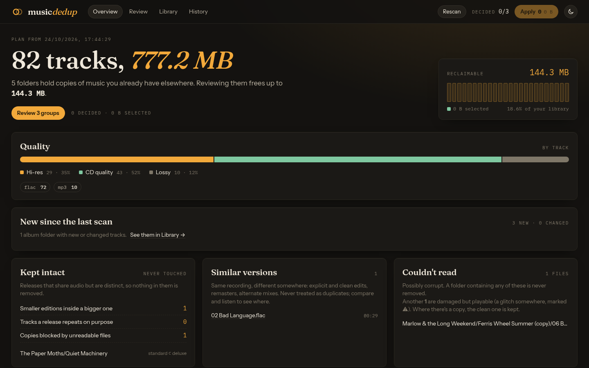
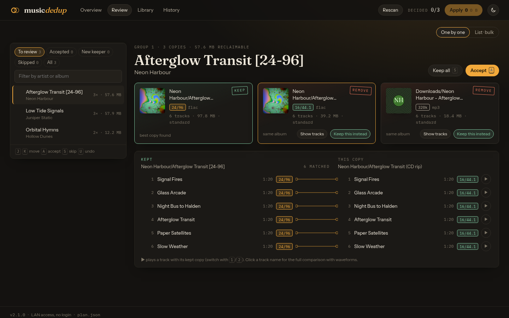
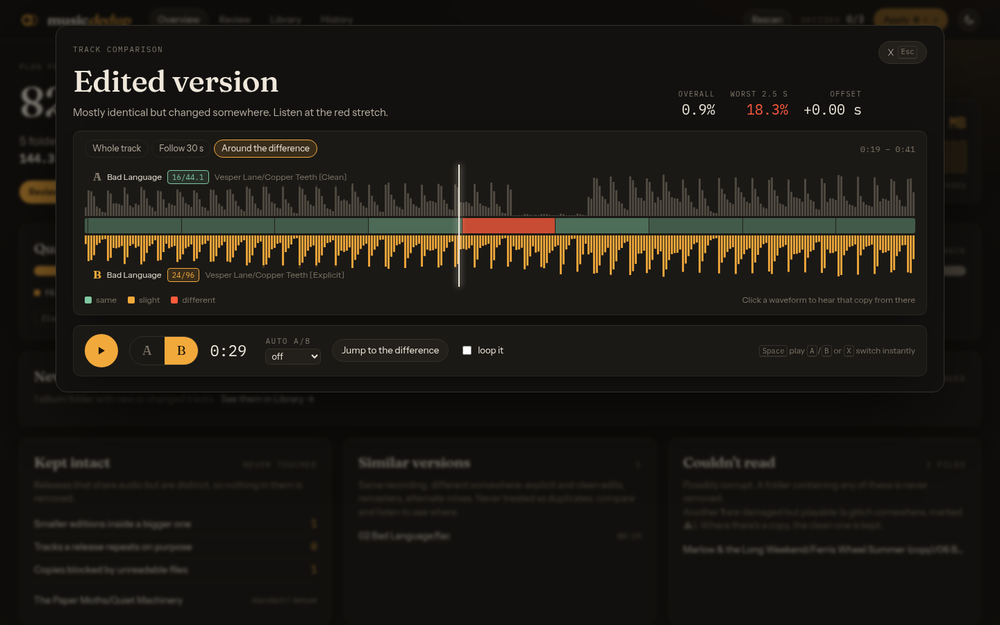
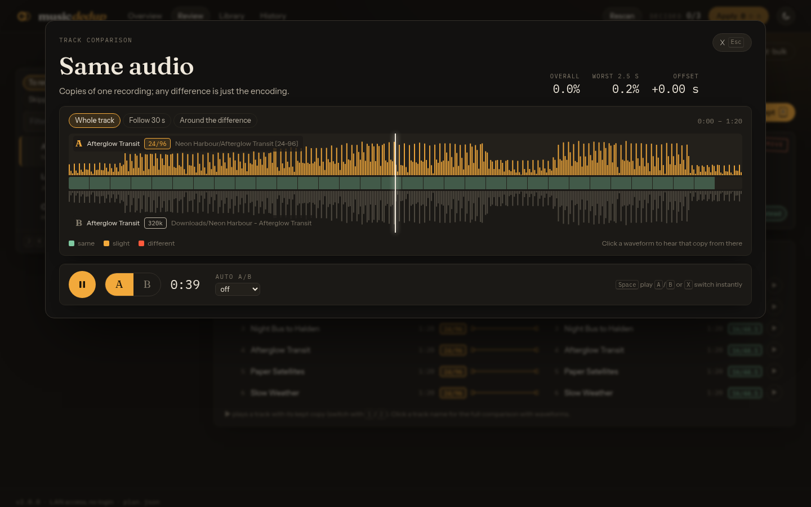
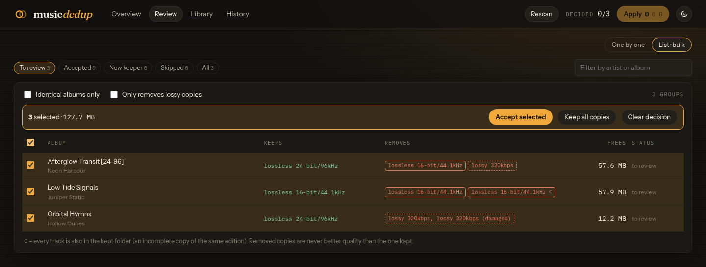
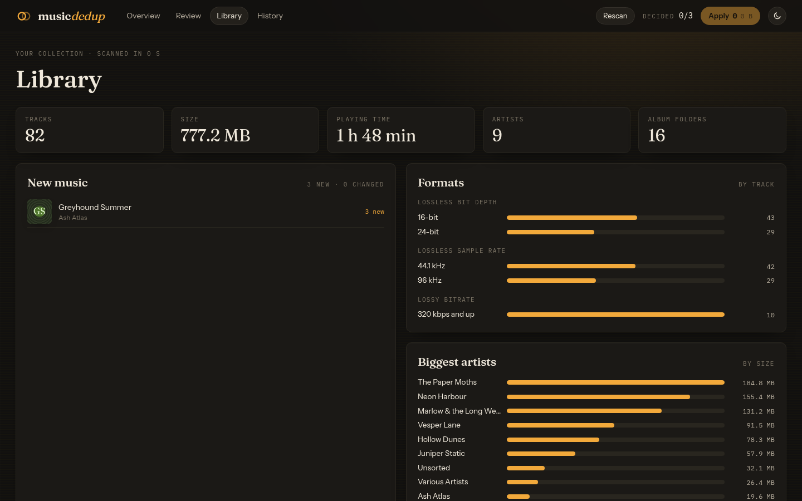
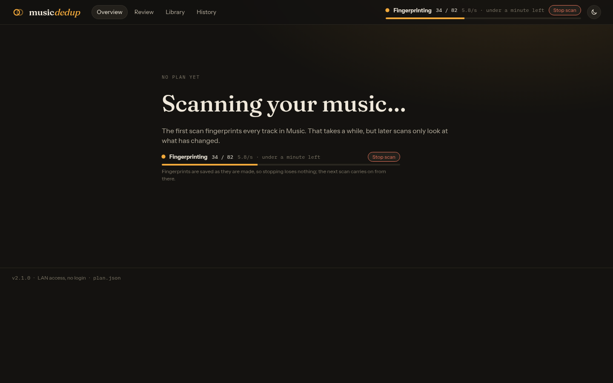
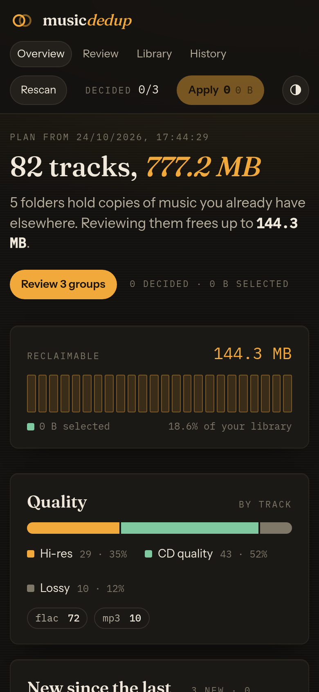
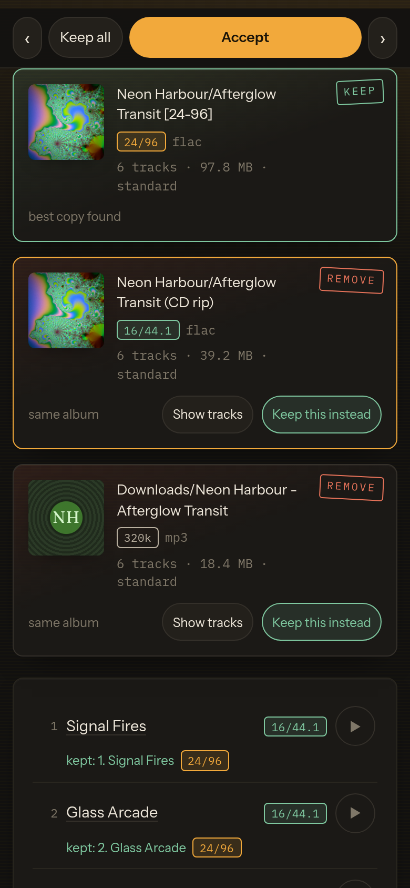
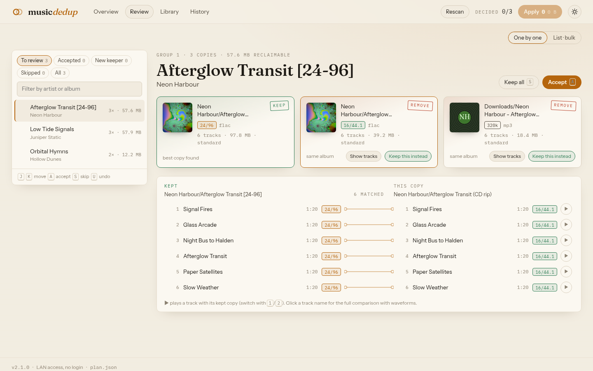

# MusicDeduplicator

Find duplicate albums and tracks in a music library by **listening to them**, not
by trusting file names or tags, then remove the duplicates safely.

- **Compares the audio itself.** Every file is fingerprinted with Chromaprint and
  compared locally, so a FLAC and an MP3 of the same album match, and so do
  copies with different or missing tags. No account, API key or internet access
  is needed.
- **Keeps the best copy.** Lossless beats lossy, hi-res beats CD quality, higher
  bitrate beats lower. A copy is only removed if one of equal or better quality is kept.
- **Keeps releases intact.** Tracks are never taken out of an album you keep. A
  standard album isn't removed just because the deluxe edition contains it, a track
  an album repeats on purpose stays, and explicit and clean versions are never
  treated as duplicates. The tool finds exactly where they differ.
- **Never acts without a plan you can review.** `scan` changes nothing. It writes a
  plan saying what it would remove and which copy it keeps instead. `apply` re-checks
  every file before touching it, moves rather than deletes by default, and records
  everything so you can undo it.
- **Copes with messy libraries.** Corrupt files, symlinks, hard links, macOS `._`
  files and NAS metadata folders are handled. Damaged files are decoded through ffmpeg
  and matched anyway. A folder holding anything unreadable is never removed.
- **Review in a browser, on a desktop or a phone.** `musicdedup serve` shows every
  duplicate with its artwork and quality. You can listen to two copies with instant A/B
  switching, decide one by one or in bulk, and rescan from the dashboard.

## Screenshots

All of these show a demo library of invented bands with synthesised music, which
[`tools/make_demo_library.py`](tools/make_demo_library.py) builds (see Development).

**Overview:** your collection at a glance, with the space you could free, what's new
since the last scan, and everything the scan found.



**Reviewing a duplicate:** the copy kept (24-bit/96 kHz) and the copies to remove, side by side.
The patch bay links every track to its match; ▶ plays a pair so you can listen to both.



**Comparing an edited version:** the clean copy (A) has a line muted. Both waveforms sit on one
timeline, and the red stretch between them shows exactly where they differ. Playback switches
between A and B instantly without losing your place.



**Comparing the same audio in two formats:** a hi-res FLAC and a 320 kbps MP3 line up bar for bar.



**Deciding in bulk:** every group in a list, with the quality kept and removed, ready to accept together.



**Library:** statistics for the whole collection, and the albums new since the last scan.



**Scanning from the dashboard:** live progress with the speed and time left, and a Stop
button that loses nothing.



**On a phone:** the same dashboard, with copies stacked and the decision buttons kept in reach.

<p>
  
  
</p>

**Light theme:**



## Install

You need Python 3.10 or newer and `fpcalc` from Chromaprint.

```bash
# 1. fpcalc
sudo apt install libchromaprint-tools     # Debian/Ubuntu
sudo dnf install chromaprint-tools        # Fedora
sudo pacman -S chromaprint                # Arch
brew install chromaprint                  # macOS
# Windows: download fpcalc from https://acoustid.org/chromaprint and put it on your PATH

# 2. musicdedup (pipx keeps it in its own environment)
pipx install git+https://github.com/JameZUK/MusicDeduplicator.git
```

If you don't have `pipx`, use a virtual environment. Recent Debian and Ubuntu
releases refuse a plain `pip install` with an "externally-managed-environment" error.

```bash
git clone https://github.com/JameZUK/MusicDeduplicator.git
cd MusicDeduplicator
python3 -m venv .venv
source .venv/bin/activate        # Windows: .venv\Scripts\activate
pip install .
```

## Use it in three steps

**1. Scan.** This only reads your files.

```bash
musicdedup scan ~/Music
```

The first scan fingerprints every file, at roughly 0.1 s per track with all CPU
cores busy. Results are cached, so later scans take seconds. It prints a report and
writes `musicdedup-plan.json`:

```
Duplicate folders: 3 folder(s) duplicate or are contained in another.
  [1] keep    Artist/Album [24-bit]  (11 tracks)
      remove  Artist/Album (CD rip)  (same album, 336.8 MB)
      remove  Downloads/Album  (same album, 298.1 MB)
  ...
Kept intact: smaller editions whose tracks are all in a bigger edition ...
Similar versions (same recording, different somewhere: edits, remasters, alternate mixes): 2 ...
Audio files that could not be read (possibly corrupt): 4 ...

Plan: remove 25 files (22 audio), freeing 635.0 MB.
```

**2. Check the plan.** Use the report above, or open `musicdedup-plan.json`. Every
file to be removed lists the copy kept instead, and why.

**3. Apply it.** Move the duplicates out of your library (recommended), or delete them.

```bash
musicdedup apply musicdedup-plan.json --move-to ~/Duplicates --dry-run   # preview
musicdedup apply musicdedup-plan.json --move-to ~/Duplicates             # do it
musicdedup undo ~/Duplicates/musicdedup-journal-20261024-084704.jsonl    # changed your mind
```

`--delete` removes files permanently instead, and asks you to type `delete` to
confirm.

If you scanned through a different (for example read-only) mount of the same files,
`--act-on SCANNED=LIVE` applies the plan to the live copy, e.g.
`--act-on /mnt/music-ro=/srv/music`. Every file is re-checked there (size and modification
time) before anything is done. The quarantine folder may then be a *hidden* folder inside
the library, such as `/srv/music/.musicdedup-quarantine`, because scans never look inside
hidden folders. Before acting on each file, `apply` checks that the file and the copy being
kept both still exist and haven't changed since the scan. Anything that fails a
check is skipped and listed.

## Review in the browser

`musicdedup serve` opens a dashboard for a plan, so you can review it visually instead
of reading the report:

```bash
musicdedup serve musicdedup-plan.json --move-to ~/Duplicates
# then open http://127.0.0.1:8650/
```

- **Overview:** collection size, the space you could free (a meter that fills as you decide),
  the split between hi-res, CD-quality and lossy tracks, new music, editions kept intact,
  similar versions, and unreadable or damaged files.
- **Review, one by one:** each duplicate group shown as album cards with their artwork
  and quality. A "patch bay" links every track to its copy in the folder being kept.
  Accept the group (<kbd>A</kbd>), keep everything (<kbd>S</kbd>) or choose a different
  copy to keep. <kbd>J</kbd>/<kbd>K</kbd> move between groups.
- **Review, as a list:** every group in a table with checkboxes, to accept or skip many
  at once. Filters include "identical albums only" and "only removes lossy copies".
- **Compare and listen:** two copies on one timeline, with both waveforms and the
  difference between them, so an edit (explicit or clean, radio edit) shows up as a red
  stretch. Both copies play in sync, and <kbd>A</kbd>/<kbd>B</kbd> switches between them
  instantly without losing your place. There's also auto-switching and a loop around
  the difference.
- **Library:** collection statistics (tracks, size, playing time, artists, formats, bit depths,
  sample rates, biggest artists and albums), what's **new since the last scan**, and a scan history.
- **Rescan:** start `serve` with `--library FOLDER` and the dashboard can rescan for you, with live
  progress and a Stop button. Stopping loses nothing: fingerprints are cached as they're made. Decisions
  carry over to the new plan for groups that haven't changed. `--scan-on-start` begins a scan when
  the server starts; without a plan yet, the dashboard shows the scan and loads the plan when it's done.
- **Apply and undo:** preview exactly what will change, do a dry run, then move (or, with
  `--allow-delete`, delete). History lists every apply, from the dashboard or the CLI,
  with one-click undo for moves.
- **Phones and tablets:** the layout adapts to small screens, with copies stacked, a
  sticky Accept / Keep all bar, and ‹ › to step between groups.

Your decisions are saved as you go, on the machine running the dashboard, so you can
stop and carry on later or from another device. Nothing changes until you press Apply,
and applying uses the same checks as `musicdedup apply`.

`--act-on` works as for `apply`, so the dashboard can rescan through one mount and act
through another.

Waveforms need `ffmpeg` on the machine running the dashboard. Comparisons load both
copies into the browser's memory first (a few seconds for hi-res files), which is what
makes switching instant.

### Who can use it

By default the dashboard only listens on `127.0.0.1`. Two ways to open it up:

| | Command | Who gets in |
|---|---|---|
| Your LAN, no login | `--host 0.0.0.0` | Only private (LAN) addresses. Narrow it with `--allow 192.168.0.0/24` |
| Behind a login proxy | `--host 0.0.0.0 --auth authelia --trusted-proxy 10.0.0.5` | Only requests from the proxy carrying its `Remote-User` header; the name is recorded in the history |

Either way, actions are protected against requests from other websites, and audio,
artwork and comparisons are only served for files in the plan. If you reach the
dashboard by a host name, add it with `--hostname dedup.example.lan` (other names are
refused, which blocks DNS-rebinding attacks). Behind a proxy, pass the original `Host`
header through. For nginx with Authelia, add `proxy_set_header Host $host;` alongside
the usual `auth_request` settings.

### Running it as a service

To keep the dashboard running and rescan whenever you like, run `serve` with
`--library` under systemd. A minimal unit:

```ini
# /etc/systemd/system/musicdedup-web.service
[Unit]
Description=musicdedup dashboard
After=network-online.target
Wants=network-online.target

[Service]
User=listener
WorkingDirectory=/home/listener/musicdedup
ExecStart=/home/listener/musicdedup/.venv/bin/musicdedup serve plan.json \
    --host 0.0.0.0 --library /srv/music --move-to /srv/music/.musicdedup-quarantine \
    --log-file dashboard.log
Nice=10
Restart=on-failure

[Install]
WantedBy=multi-user.target
```

The first start shows the scan screen; press Scan, or add `--scan-on-start`. If the music
is on a network or automounted share, order the unit after that mount (for an automount,
`Wants=` and `After=` on its `.automount` unit, so that the share unmounting when idle
doesn't stop the service).

## What counts as a duplicate

| Situation | What happens |
|---|---|
| Two folders with the same audio (any formats, any tags) | The best-quality folder is kept; the others are removed |
| A folder whose tracks are all in a bigger folder of the **same** edition (an incomplete copy) | Removed |
| A standard album whose tracks are all on the deluxe edition | **Kept** and reported. Add `--remove-smaller-editions` to remove it |
| The better copy is the smaller folder (e.g. FLAC album vs MP3 deluxe) | Both kept; nothing of better quality is ever removed |
| Explicit vs clean, radio edit, any version edited somewhere | Not a duplicate. Reported with the time where they differ |
| Different mix or remaster with different timing | Not a duplicate |
| Some tracks shared (compilations, best-ofs, partial overlap) | Both kept. Reported as shared tracks |
| The same track twice in one folder by accident (FLAC + MP3, `Song (1).flac`, same track number) | Reported. Add `--within-folders` to remove the extra copy |
| An album that repeats a track on purpose (different track numbers) | Kept intact |
| A folder containing an unreadable or corrupt audio file | Never removed. Corrupt files are listed |
| A damaged but playable file (a glitch the decoder skips) | Still matched, by decoding through ffmpeg. Where there's a copy, the clean one is kept; a damaged lossless copy still beats a clean lossy one |
| Silence, very short tracks | Never used as evidence of a duplicate on their own |
| Symlinks, hard links | Ignored (they aren't extra copies) |

When several copies are equally good, the tool keeps the copy with more tracks,
then better quality, then the one under a `--prefer` folder, then the
shallowest path, then the first alphabetically. The same library always produces
the same plan.

Only files directly inside a removed folder are removed: its audio plus its
artwork, `.nfo`, `.cue` and similar files. Subfolders are separate folders with
their own decision. Artwork is only removed once every audio file in the folder
has actually gone.

## Options

```
musicdedup scan LIBRARY [LIBRARY ...]
  -o, --plan FILE              where to write the plan (default: musicdedup-plan.json)
  --prefer FOLDER              keep copies under this folder when copies are equally good (repeatable)
  --remove-smaller-editions    also remove an edition whose tracks are all in a bigger one
  --within-folders             also remove accidental duplicate copies inside a folder
  --exclude PATTERN            skip folders matching a name or relative path pattern (repeatable)
  --workers N                  parallel fingerprinting jobs (default: number of CPUs)
  --cache FILE / --no-cache    fingerprint cache (default: ~/.cache/musicdedup/fingerprints.db)
  --full-report                print every entry instead of the first 25

musicdedup apply PLAN (--move-to DIR | --delete) [--dry-run] [--yes] [--journal FILE]
                 [--act-on SCANNED=LIVE]
musicdedup undo JOURNAL [--dry-run]
musicdedup serve PLAN [--host ADDR] [--port 8650] [--move-to DIR] [--allow-delete]
                 [--auth none|authelia] [--allow CIDR] [--trusted-proxy CIDR] [--hostname NAME]
                 [--library FOLDER] [--scan-on-start] [--act-on SCANNED=LIVE] [--cache FILE]
                 [scan options: --exclude, --prefer, --within-folders, --workers, ...]
musicdedup cache info|clear

All commands: -v/--verbose, -q/--quiet, --log-file FILE
```

Scanning several folders at once (for example `musicdedup scan ~/Music ~/Downloads
--prefer ~/Music`) finds duplicates across them. In quarantine, each scanned folder
gets its own subfolder.

Scheduled and unattended runs work: `scan` never prompts, and `apply` refuses to
proceed without `--yes` when it isn't run from a terminal.

## How it works

1. **Scan.** Walks the folders without following symlinks and fingerprints each audio
   file with `fpcalc` (the whole track, in parallel). If `fpcalc` can't read a file, it's
   decoded through `ffmpeg`, skipping bad frames, and marked damaged if anything was skipped. Fingerprints, format and tags are
   cached, keyed by path, size and modification time to the nanosecond.
2. **Compare.** Tracks of similar length are compared by aligning their fingerprints
   and measuring the fraction of differing bits, overall and in 2.5-second windows.
   - Re-encodes of the same audio differ by under 10% overall, with no window above 13%.
   - An edited version differs little overall but has a window with a big difference,
     which pinpoints the edit.
   - Different mixes and different songs differ by 25% or more.

   These thresholds were measured on real libraries.
3. **Plan.** Folders are ranked, and each one is removed only if a higher-ranked kept
   folder holds an equal-or-better copy of every track in it. The plan is a JSON file;
   see `src/musicdedup/planner.py` for its layout.
4. **Apply.** Every file is re-checked against the plan before it's touched. Moves never
   overwrite, and every action is written to a journal immediately.

## Upgrading from 1.x (`musicorganise.py`)

Version 2 is a rewrite. AcoustID is no longer used: version 1 trusted AcoustID's
recording IDs, which treat explicit and clean versions as the same recording and
can give identical files different IDs. Version 2 compares the audio directly and
needs no API key. Your old `config.json` and `file_cache.db` are no longer used and
can be deleted.

`python3 musicorganise.py -p PATH -a list|move|delete [-m DIR] [--dry-run] [-y]` still
works as a wrapper around the new commands, but `musicdedup` is recommended.

## Development

```bash
pip install -e '.[dev]'
ruff check .
pytest                 # integration tests run when ffmpeg and fpcalc are installed
```

The dashboard's source is in `web/` (Svelte + Vite). Its build output is committed under
`src/musicdedup/web/static/`, so installing never needs Node. After changing the UI:

```bash
cd web && npm install && npm run build      # npm run dev proxies to a running `musicdedup serve`
```

To try the tool, or the dashboard, without touching your own music, build the demo
library (invented bands, synthesised audio, about 750 MB; needs ffmpeg):

```bash
python tools/make_demo_library.py ~/demo
musicdedup serve ~/demo/plan.json --library ~/demo/Music --within-folders --move-to ~/demo/Quarantine
python tools/make_demo_library.py ~/demo --later   # adds an album, to see "new music" on a rescan
```

## License

MIT. See [LICENSE](LICENSE).
